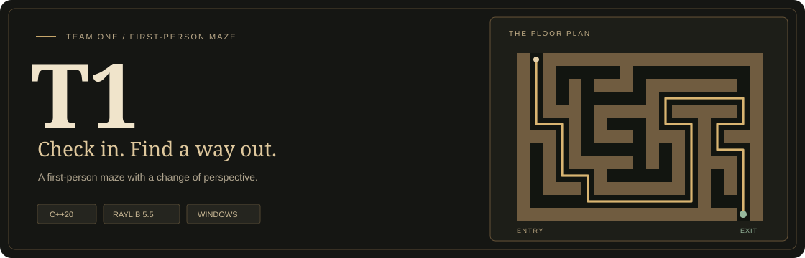

<a id="top"></a>

<div align="center">



<p><strong>Find the exit. Change your gravity. Beat your best time.</strong></p>

<p>
  
  
  
  
</p>

<p>
  <a href="#first-time-setup">Setup</a> &nbsp; / &nbsp;
  <a href="#run-with-f5-in-vs-code">Run with F5</a> &nbsp; / &nbsp;
  <a href="#playing">Controls</a> &nbsp; / &nbsp;
  <a href="#project-layout">Project layout</a> &nbsp; / &nbsp;
  <a href="#troubleshooting">Help</a>
</p>

</div>

A C++20 maze game built with raylib 5.5. Find the green exit before time runs
out, explore generated mazes, and use gravity switching to move onto walls and
ceilings. Player profiles and best times are saved between sessions.

<table>
  <tr>
    <td width="33%" valign="top">
      <h3>🧭 Explore</h3>
      <p>Generated mazes, three difficulty presets, and custom sizes from 10 to 50.</p>
    </td>
    <td width="33%" valign="top">
      <h3>🌀 Change gravity</h3>
      <p>Aim at a wall or ceiling and press <kbd>G</kbd> to find a new way through.</p>
    </td>
    <td width="33%" valign="top">
      <h3>⏱ Beat your time</h3>
      <p>Up to five player profiles, with personal best times saved for each maze size.</p>
    </td>
  </tr>
</table>

## Requirements

- Windows with an x64 build environment.
- Visual Studio 2026 with **Desktop development with C++** and a Windows SDK.
- The **raylib 5.5 source files**, downloaded separately as described below.
- For VS Code: Microsoft's **C/C++** extension (`ms-vscode.cpptools`). Visual
  Studio's C++ build tools are still required.

The project uses MSBuild. Both Debug and Release compile the game and tests as
C++20; raylib's `.c` files compile as C.

## First-time setup

1. Download the [raylib 5.5 source ZIP](https://github.com/raysan5/raylib/archive/refs/tags/5.5.zip).
2. Extract the complete `raylib-5.5` folder into your Windows user folder.
3. Check that these files exist before building:

   ```text
   C:\Users\<your-user>\raylib-5.5\
     src\raylib.h
     src\external\glfw\include\GLFW\glfw3.h
   ```

The default raylib location is `%USERPROFILE%\raylib-5.5`. Download and extract
it once; future builds reuse those source files and compile the library locally.

### Using a different raylib location

<details>
<summary><strong>Configure a custom raylib folder</strong></summary>

Set `RAYLIB_SOURCE` to the folder containing raylib's `src` directory. For
example, run this in PowerShell, then restart your editor so it reads the setting:

```powershell
[Environment]::SetEnvironmentVariable('RAYLIB_SOURCE', 'D:\Libraries\raylib-5.5', 'User')
```

For a single MSBuild command, you can instead add
`/p:RaylibSource="D:\Libraries\raylib-5.5"`.

</details>

## Run with F5 in VS Code

<div align="center">
<p><kbd>Open Team1</kbd> &nbsp; → &nbsp; <kbd>Run MazeGame</kbd> &nbsp; → &nbsp; <kbd>F5</kbd></p>
</div>

1. Open the **Team1 folder** containing `MazeGame.sln` in VS Code.
2. Install the **C/C++** extension if needed.
3. Open **Run and Debug** with **Ctrl+Shift+D** and select **Run MazeGame**.
4. Press **F5** to build and start the game with the debugger.

After selecting the configuration once, use **F5** for subsequent runs. It builds
the game in **Debug | x64**, regardless of which source file is open.
**Ctrl+F5** runs without the debugger; **Ctrl+Shift+B** builds without launching.

The launch and build settings are in [`.vscode/launch.json`](.vscode/launch.json)
and [`.vscode/tasks.json`](.vscode/tasks.json).

## Run in Visual Studio

1. Open **MazeGame.sln**.
2. Select **Debug | x64** or **Release | x64**.
3. Right-click **MazeGame** and choose **Set as Startup Project**.
4. Press **F5** to build and debug, or **Ctrl+F5** to run without debugging.

The solution includes the game, raylib, and three test executables. Build output
goes into `build-vs/x64/Debug/` or `build-vs/x64/Release/`.

For terminal builds, expand the commands below.

<details>
<summary><strong>Command-line build options</strong></summary>

To build the whole solution from **Developer PowerShell for Visual Studio**, run
this from the project folder:

```powershell
msbuild .\MazeGame.sln /m /p:Configuration=Debug /p:Platform=x64
```

To build just the game from a regular PowerShell terminal:

```powershell
powershell -NoProfile -ExecutionPolicy Bypass -File .\windows\Build.ps1
```

</details>

## Playing

Choose **Play**, select or create a player, and choose a difficulty or a custom
maze size. Custom sizes range from **10 to 50**. The game supports up to **five
players**, with names of **1–12 letters, digits, or underscores**. Best times are
recorded for each player and maze size.

| Control | Action |
| --- | --- |
| <kbd>W</kbd> <kbd>A</kbd> <kbd>S</kbd> <kbd>D</kbd> or arrow keys | Move through the maze |
| Mouse | Look around |
| <kbd>G</kbd> | Switch gravity; aim at a wall or ceiling to attach |
| <kbd>Esc</kbd> | Pause during a run or go back in menus |
| <kbd>↑</kbd> / <kbd>↓</kbd> or <kbd>W</kbd> / <kbd>S</kbd> | Choose a menu option |
| <kbd>Enter</kbd> or <kbd>Space</kbd> | Confirm a menu selection |
| <kbd>Delete</kbd> | Remove the selected player on the player selection screen |

## Save files

Profiles and records are stored in the project's `save_data/` folder:

| File | Contents |
| --- | --- |
| `players.txt` | Player names |
| `best_times.txt` | Each player's best times by maze size |

The game creates the folder when it needs to save. The supplied VS Code and
Visual Studio launch settings use the project folder as the working directory.
If you launch the executable manually, run it from that folder to use the same
save files.

## Project layout

```text
Team1/
  src/
    data/              Maze data, file storage, and validation
    logic/             Gameplay, difficulty, and player management
    presentation/      Screens, rendering, menus, and input
    main.cpp           Application entry point
  save_data/           Saved profiles and best times
  tests/               Core, gameplay, and input tests
  windows/             Visual Studio projects and PowerShell helpers
  .vscode/             VS Code build, launch, and editor settings
  build-vs/            Generated build output (ignored by Git)
  MazeGame.sln         Visual Studio solution
  README.md
```

When adding source files, also add them to `windows/MazeGame.vcxproj` through
Visual Studio's **Add > Existing Item** or **Add > New Item**. The matching
`.vcxproj.filters` file controls their grouping in Solution Explorer.

## Tests

<details>
<summary><strong>Build and run all three test suites</strong></summary>

Build the **whole solution** first; the VS Code F5 task builds only the game and
its raylib dependency. Then run the test helper from the project folder:

```powershell
msbuild .\MazeGame.sln /m /p:Configuration=Debug /p:Platform=x64
powershell -NoProfile -ExecutionPolicy Bypass -File .\windows\RunTests.ps1
```

For Release, build with `/p:Configuration=Release` and add
`-Configuration Release` to the test command. Tests use isolated directories
under `build-vs` for their save files.

</details>

## Troubleshooting

| Problem | What to check |
| --- | --- |
| `raylib 5.5 was not found` | Extract the complete source folder to `%USERPROFILE%\raylib-5.5`, or configure `RAYLIB_SOURCE` and restart the editor. |
| MSBuild or C++ tools are missing | Install Visual Studio's **Desktop development with C++** workload and a Windows SDK. |
| F5 asks for a launch configuration | Open the full project folder and select **Run MazeGame** in Run and Debug. |
| The test helper says an executable is missing | Build `MazeGame.sln` in the same configuration as the test command. |
| Existing profiles or records do not appear | Check that the working directory is the project folder containing `save_data/`. |

## Dependency

[raylib 5.5](https://github.com/raysan5/raylib/tree/5.5) is distributed under the
zlib license. Its source files and license remain in your downloaded raylib
folder.

<hr>

<div align="center">
<p><strong>Built by Team 1 with C++20 and raylib.</strong></p>
<a href="#top">Back to top ↑</a>
</div>
