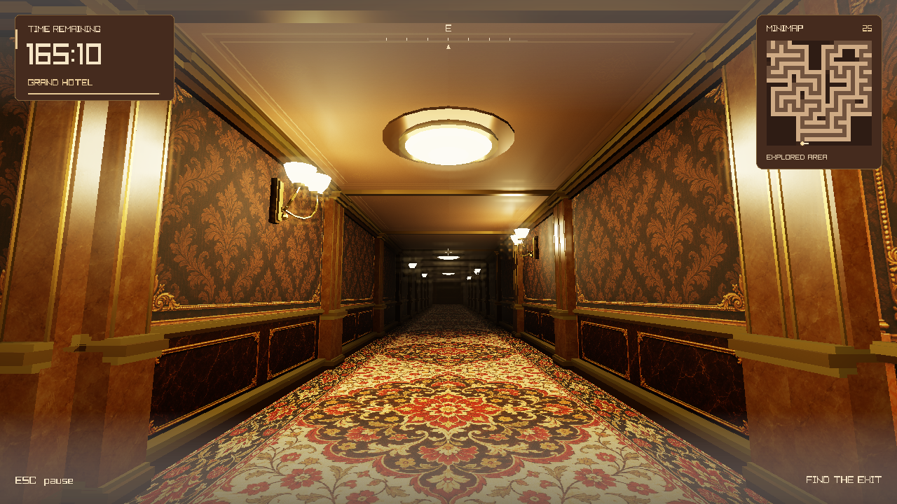

# T1

A first-person maze game built with C++20 and raylib. Explore hotel corridors, reach the exit before the timer runs out, or play Zero Gravity mode to switch between the floor and ceiling.



## Project layout

```text
docs/                   Project documentation and screenshots
src/
  assets/               Textures, menu artwork and legacy import files
  data/                 Maze data, persistence and shared types
  logic/                Gameplay and movement
  presentation/         Rendering, shaders, menus and HUD
  tests/                Core, gameplay, input and graphics checks
  windows/              Visual Studio solution, projects and build scripts
  main.cpp              Application entry point
README.md
```

`.vscode/` provides the root workspace's F5 configuration. Build output goes into `build-vs/`; local profiles, scores and settings live in `save_data/`.

The two old text save files are kept under `src/assets/legacy/` for one-time import. The game reads them there without copying them back to the root; current progress remains in the ignored `save_data/maze_game.db` file.

## Build and run on Windows

Install Visual Studio or Visual Studio Build Tools with **Desktop development with C++** and a Windows SDK. The first build downloads raylib 5.5; subsequent builds use the local dependency cache.

For VS Code, install Microsoft's C/C++ extension, open the repository root and press **F5**. For Visual Studio, open `src/windows/MazeGame.sln` and select **Debug | x64**.

From PowerShell in the repository root:

```powershell
powershell.exe -NoProfile -ExecutionPolicy Bypass -File .\src\windows\Build.ps1
.\build-vs\x64\Debug\MazeGame.exe
```

## Controls

| Action | Input |
| --- | --- |
| Move | W/A/S/D or arrow keys |
| Look | Mouse |
| Jump | Space or mouse wheel |
| Switch gravity in Zero Gravity mode | G |
| Confirm a menu choice | Enter |
| Pause or go back | Escape |

## Tests

In a Visual Studio Developer PowerShell, build the solution and run the test launcher from the repository root:

```powershell
MSBuild.exe .\src\windows\MazeGame.sln /m /p:Configuration=Debug /p:Platform=x64
powershell.exe -NoProfile -ExecutionPolicy Bypass -File .\src\windows\RunTests.ps1
```

Tests use isolated data directories. See [database notes](docs/DATABASE.md) for save storage and [code organization](docs/CODE_STYLE.md) for implementation details.
