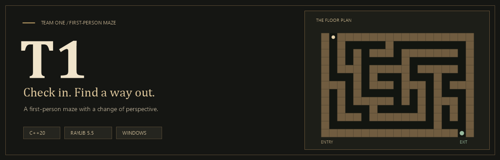
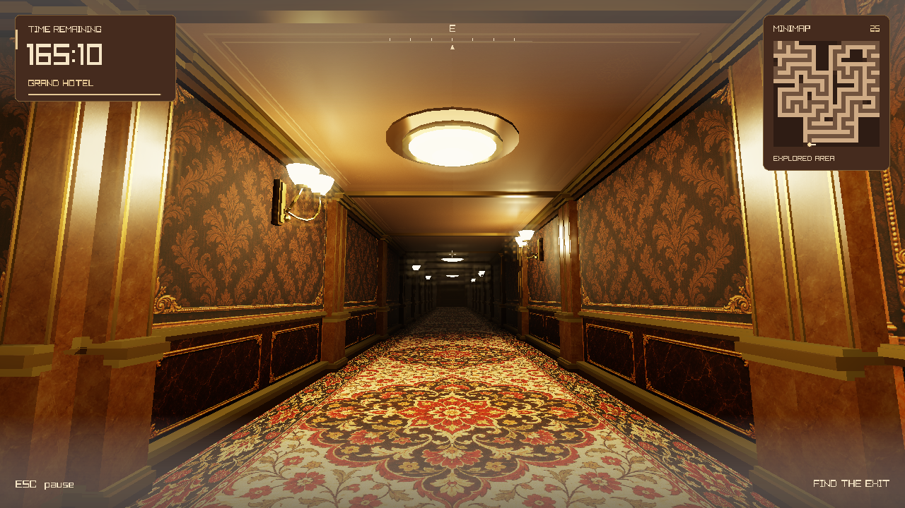
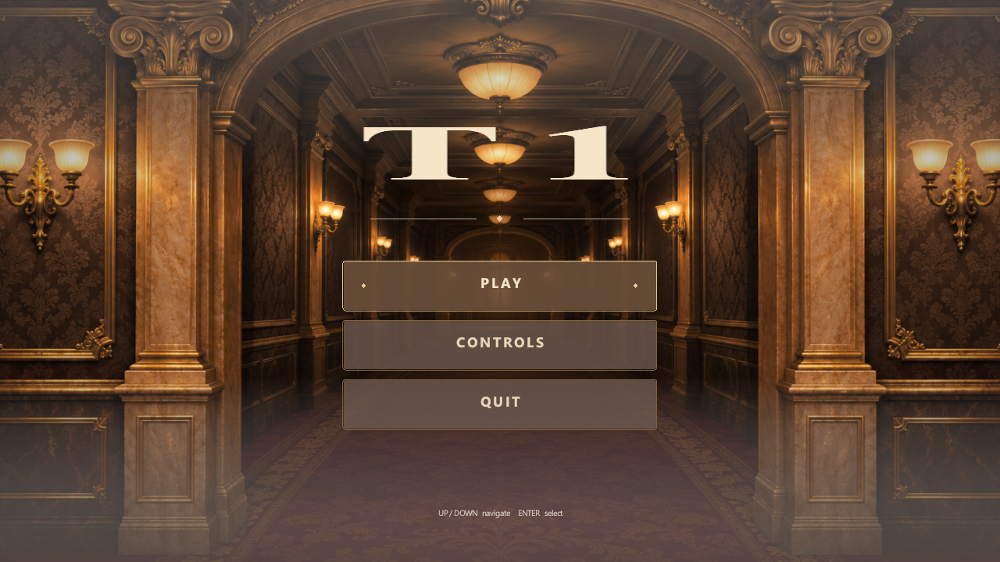
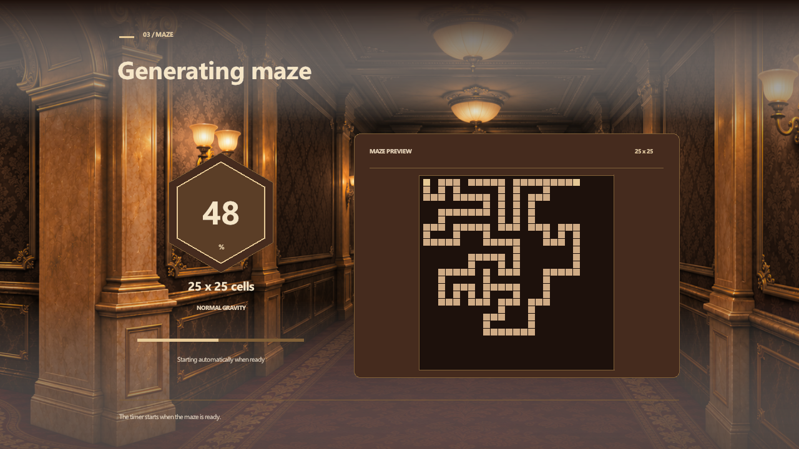

<picture>
  <source media="(prefers-reduced-motion: reduce)" srcset="docs/assets/ReadmeBanner.svg">
  
</picture>

<strong>Warm lights. Winding corridors. One way out.</strong>

A first-person maze game built with C++20 and raylib.

  <a href="#check-in">Get started</a> &nbsp; / &nbsp;
  <a href="#a-look-inside">Screenshots</a> &nbsp; / &nbsp;
  <a href="#find-your-way">How to play</a> &nbsp; / &nbsp;
  <a href="#under-the-floorboards">The code</a>

The banner is an animated maze illustration. <a href="docs/assets/ReadmeBanner.svg">View the still version.</a>

 

T1 turns a generated maze into a grand hotel: patterned walls, woven runners, stone columns,
and pools of warm light. Find the exit before the countdown ends. Learn the route, time your
jumps, and use the ceiling when the floor is the wrong place to be.

<table>
<tr>
<td width="33%" valign="top">
<h3>01 / Find the route</h3>

Procedurally generated layouts, three difficulty presets, and custom mazes. A brief map peek helps you orient yourself without revealing unexplored passages.

</td>
<td width="33%" valign="top">
<h3>02 / Change perspective</h3>

Zero Gravity turns the ceiling into a second path. Alternate surfaces to bypass lethal barriers; side walls stay ordinary walls.

</td>
<td width="33%" valign="top">
<h3>03 / Make it your run</h3>

Buffered jumps, air acceleration, adjustable mouse sensitivity, and personal bests for each profile, maze size, and mode.

</td>
</tr>
</table>

## A look inside

The hotel corridor: warm fixtures, stonework, and a continuous woven runner.

<strong>Open the guestbook: menus and maze preparation</strong>

 

<table>
<tr>
<td width="50%"></td>
<td width="50%"></td>
</tr>
<tr>
<td align="center"><strong>The entrance</strong></td>
<td align="center"><strong>Preparing your route</strong></td>
</tr>
</table>

## Check in

**Windows x64** is the supported build target. Before the first run, install:

- Visual Studio or Visual Studio Build Tools with **Desktop development with C++** and a **Windows SDK**.
- For VS Code, Microsoft's **C/C++** extension: `ms-vscode.cpptools`.
- A graphics driver with **OpenGL 3.3** support.

The first build needs an internet connection to restore raylib 5.5. Its sources are cached
outside the repository and reused on later builds. No database server is needed.

### VS Code: open the folder, then F5

1. Clone or extract the project.
2. Open the **repository root** in VS Code: the folder containing `.vscode/` and `src/`.
3. Open **Run and Debug** with **Ctrl+Shift+D** and choose **Run MazeGame**.
4. Press **F5** and let the build finish.

F5 builds the game before launching it. The first build takes longer because raylib also
needs to be compiled. Subsequent runs reuse the dependency cache and existing build output.

> Opening a `.sln` as a text file in VS Code does not load the launch configuration.
> Open the complete project folder.

<strong>Using Visual Studio or a terminal instead</strong>

Open `src/windows/MazeGame.sln` in Visual Studio, select **Debug | x64**, set **MazeGame**
as the startup project, and press **F5**.

From a regular CMD terminal at the repository root:

~~~cmd
powershell.exe -NoProfile -ExecutionPolicy Bypass -File src\windows\Build.ps1
build-vs\x64\Debug\MazeGame.exe
~~~

Run the executable only after the build succeeds. Keep the repository root as the
working directory to use its `save_data/` folder.

<strong>Offline builds and the raylib cache</strong>

The automatic cache lives at:

~~~text
%LOCALAPPDATA%\MazeGame\Dependencies\raylib-5.5
~~~

A complete source checkout at `%USERPROFILE%\raylib-5.5` is also recognized.
For another location, set `RAYLIB_SOURCE` to the raylib 5.5 directory containing `src/`,
then restart the editor.

Example in PowerShell:

~~~powershell
[Environment]::SetEnvironmentVariable('RAYLIB_SOURCE', 'D:\Libraries\raylib-5.5', 'User')
~~~

An invalid override prevents automatic setup, so remove or correct it before retrying.

## Find your way

Select **Play**, choose or create a profile, and pick a level.

| Level | Maze | Time |
| :--- | :---: | ---: |
| Easy | 15 × 15 | 180 seconds |
| Medium | 25 × 25 | 150 seconds |
| Hard | 40 × 40 | 120 seconds |
| Zero Gravity | 25 × 25 | 180 seconds |
| Custom / Normal | 10–50 cells per side | Side length × 5 seconds |

<table>
<tr>
<td width="50%" valign="top">
<h3>Normal</h3>

Navigate on the floor, find the exit, and beat the timer. Buffered jumps and air acceleration reward well-timed bunny hops.

</td>
<td width="50%" valign="top">
<h3>Zero Gravity</h3>

Press <kbd>G</kbd> to switch between floor and ceiling. Use the opposite surface to pass a barrier. Touching a barrier ends the run.

</td>
</tr>
</table>

### Your keys

| Input | Action |
| :--- | :--- |
| <kbd>W</kbd> <kbd>A</kbd> <kbd>S</kbd> <kbd>D</kbd> / arrow keys | Move |
| Mouse | Look around |
| <kbd>Space</kbd> / mouse wheel | Request a jump |
| <kbd>G</kbd> | Flip floor ↔ ceiling in Zero Gravity |
| <kbd>E</kbd> | Peek at the explored map |
| <kbd>Esc</kbd> | Pause a run / go back in menus |
| <kbd>Up</kbd> / <kbd>Down</kbd> or <kbd>W</kbd> / <kbd>S</kbd> | Navigate menu options |
| <kbd>Enter</kbd> / <kbd>Space</kbd> | Confirm a menu choice |
| <kbd>Delete</kbd> | Delete the selected saved profile on the profile screen |

**Map peek:** visible for 1 second, or 2 seconds in Zero Gravity and mazes larger than
30 cells per side. A 3-second cooldown follows each peek.

**Mouse sensitivity:** adjust it in the pause menu from **25% to 300%**. The default is 100%.

Losing window focus or minimizing pauses the run. Returning to the window keeps it paused
until you explicitly resume.

## Your guestbook stays local

Up to **five profiles** can be saved, with names of **1–12 ASCII letters, digits, or underscores**.

| Local file | What it keeps |
| :--- | :--- |
| `save_data/maze_game.db` | SQLite profiles and personal bests, separated by player, maze size, and mode |
| `save_data/settings.txt` | Mouse-sensitivity preference |

SQLite comes from Windows; there is no separate server or SQLite installation to configure.
Only a first or faster valid time replaces a record. A failed save is reported on the
results screen.

Legacy profile and score text files are imported once when present beside the database.
They remain untouched as backups. Builds do not bundle your personal progress.

To move progress to another PC, close the game and copy the database and, optionally,
the settings file into the other copy's `save_data/` directory.
See [the storage notes](docs/Database.md) for migration and recovery details.

## Under the floorboards

~~~text
Team1/
├── .vscode/                F5 build and debugger configuration
├── src/
│   ├── Main.cpp            Window creation and application entry point
│   ├── data/               Maze representation, validation, SQLite, and file storage
│   ├── logic/              Movement, gravity, obstacles, profiles, and settings
│   ├── presentation/       Screens, input, rendering, materials, shaders, and HUD
│   ├── assets/             Artwork and bundled fonts
│   ├── tests/              Core, gameplay, input, UI, and graphics checks
│   └── windows/            Visual Studio solution, projects, and build helpers
├── docs/                   Documentation and README artwork
├── save_data/              Local progress and preferences; ignored by Git
└── build-vs/               Generated executables and object files; ignored by Git
~~~

`Main.cpp` creates `Application`, which coordinates the screens and owns the current run.
The logic layer advances gameplay; the presentation layer reads that state to draw it.
Storage keeps profiles and records independently of the rendering code.
See the [project documentation](docs/T1Documentation.docx) and [presentation](docs/T1Presentation.pptx)
for the full project materials.

<strong>Build and run the three test suites</strong>

Use a **Visual Studio Developer Command Prompt** at the repository root:

~~~cmd
msbuild src\windows\MazeGame.sln /m /p:Configuration=Debug /p:Platform=x64
powershell.exe -NoProfile -ExecutionPolicy Bypass -File src\windows\RunTests.ps1
~~~

Build the whole solution first. The ordinary F5 task builds the game and raylib, but not
the test executables.

The runner executes `MazeGameTests`, `MazeGameLogicTests`, and `MazeInputTests` using isolated
test-data directories. Coverage includes maze connectivity, storage and migrations,
movement and jumps, gravity obstacles, input, resource ownership, and rendered lighting.

For Release, build with `/p:Configuration=Release` and pass `-Configuration Release`
to `RunTests.ps1`.

<strong>Adding a source file</strong>

Add new game source files to `src/windows/MazeGame.vcxproj`, using Visual Studio's
**Add → Existing Item** or **Add → New Item** when convenient.
The matching `.vcxproj.filters` file controls their visual grouping in Solution Explorer.

Keep graphics resources scoped so they are destroyed before `CloseWindow()`.
See [the code-style notes](docs/CodeStyle.md) for the project's conventions.

## Essential test cases

[View the test cases (PDF)](docs/T1TestCases.pdf) - 12 important tests across three pages covering startup, gameplay, gravity hazards, settings, and saved records. Completed entries are illustrative examples, not verified execution results.

## If the door will not open

| Symptom | Check |
| :--- | :--- |
| F5 offers to debug “Plain Text” | Open the repository folder and select **Run MazeGame**. The solution file is opened as text in VS Code. |
| `MazeGame.exe` does not exist | Check the build terminal, fix its first error, and rerun F5. The executable is generated locally. |
| MSBuild or C++ tools are missing | Install the C++ desktop workload and a Windows SDK. VS Code alone does not include the compiler. |
| raylib cannot be restored | Check first-build internet access and any custom `RAYLIB_SOURCE` value. Offline builds need a complete 5.5 source checkout. |
| A test executable is missing | Build `src/windows/MazeGame.sln` in the same configuration as the test runner. |
| Your profiles or times are missing | Check the working directory and its `save_data/maze_game.db`. |
| A result cannot be saved | Check write permissions and database locks; see [storage recovery](docs/Database.md). |

---

<strong>Built by Team 1.</strong>

C++20 · <a href="https://github.com/raysan5/raylib/tree/5.5">raylib 5.5</a> · Windows SQLite

raylib is distributed under the zlib license; its license remains with the cached dependency.

<a href="#top">Return to the entrance ↑</a>

